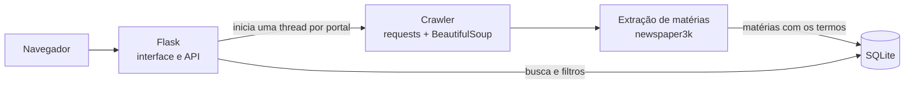

# Monitor de Notícias

Aplicação web de clipping automatizado: percorre portais de notícias, extrai o texto das matérias e guarda apenas as que mencionam os temas de interesse, com busca e filtros para consulta.


## O problema

Acompanhar o que a imprensa publica sobre um setor exige abrir dezenas de portais todos os dias e procurar manualmente as matérias relevantes. Para uma agência reguladora, por exemplo, isso significa monitorar notícias sobre saneamento, energia, gás e transporte em todos os veículos regionais. Este sistema automatiza essa coleta e entrega só o que importa.

## Funcionalidades

- **Cadastro de portais e termos de busca** pela interface, com importação e exportação em arquivo de texto
- **Coleta automática em paralelo**: cada portal é percorrido em uma thread própria, seguindo apenas links internos
- **Extração do conteúdo** das matérias (título, texto e data de publicação) com newspaper3k
- **Filtro por relevância**: só são armazenadas as matérias que contêm algum dos termos cadastrados
- **Acompanhamento em tempo real** do progresso por portal, com opção de interromper a coleta
- **Busca das matérias** por termo, portal e período, com ordenação e paginação

## Arquitetura



## Boas práticas de coleta

- Limite de 50 páginas por portal em cada execução
- Intervalo de 1 segundo entre requisições ao mesmo portal
- Controle de URLs já visitadas para não repetir páginas
- Tempo limite de 15 segundos por requisição e tratamento de erros de rede

## Como executar

```bash
git clone https://github.com/gabrieldeoliver1/monitor-de-noticias.git
cd monitor-de-noticias
pip install -r requirements.txt
python app.py
```

Acesse `http://127.0.0.1:5000`. O banco de dados SQLite é criado automaticamente na primeira execução. A pasta `exemplos/` traz uma lista de 44 portais de notícias de Alagoas e termos de busca de exemplo, que podem ser importados pela interface.

## Estrutura do projeto

```
├── app.py          # Rotas da interface e da API
├── scraper.py      # Crawler e extração das matérias
├── database.py     # Criação do banco e consultas
├── templates/      # Páginas em Jinja2
├── static/         # CSS e JavaScript
└── exemplos/       # Portais e termos de exemplo
```

## Próximos passos

- Respeitar automaticamente o `robots.txt` de cada portal
- Agendar a coleta para rodar todos os dias sem intervenção manual
- Enviar um resumo diário das matérias por e-mail
- Classificar o sentimento das matérias (positivo, neutro ou negativo) com NLP

## 🔗 Contato

[](https://www.linkedin.com/in/gabrieldeoliver1/)

Email: gabrieldeoliver1@gmail.com
